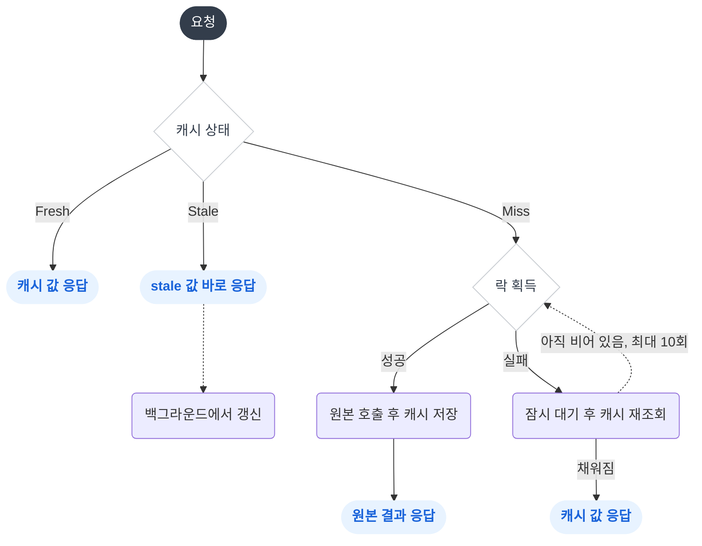

## 개요

안녕하세요! 식스샵에서 **웹 빌더 도메인**과 **BFF(Backend for Frontend) 서버**를 맡고 있는 백엔드 개발자입니다.
두 서버는 하나의 NestJS 모노레포 안에서 함께 지내고 있는데요.

**웹사이트 서버**는 판매자가 에디터로 만든 홈페이지를 응답하고, **BFF 서버**는 프론트엔드와 여러 마이크로서비스 사이의 의사소통을 팔로업하고, 화면에 필요한 데이터를 적절히 응답합니다.

최근 큰 규모의 고객사 이전으로 부하 안정성 개선이 사내 최우선 과제가 됐습니다.
이벤트가 열리면 수많은 방문자가 같은 홈페이지와 같은 상품을 동시에 엽니다. 이 트래픽을 두 서버가 앞에서 받아 내고, 뒤쪽 서비스로 가는 요청은 최대한 줄여야 했습니다.

두 서버 모두 캐시는 이미 쓰고 있었지만, 필요한 곳에 그때그때 붙여 둔 수준이었습니다.
이번에는 캐시를 부하 대응을 위한 주력 수단으로 삼기로 했는데요. 이유는 세 가지였습니다.

1. **병목은 대부분 다른 서비스에 있었습니다.** 외부 호출을 모두 모킹하면 300 TPS를 오류 없이 처리했지만, 리뷰 서비스 하나만 실제로 호출해도 p95가 9.71초까지 늘었습니다.
2. **데이터가 캐시하기 좋았습니다.** 홈페이지 데이터는 판매자가 저장하기 전까지 바뀌지 않고, BFF가 모으는 상품, 스토어 정보도 읽기가 압도적이었습니다.
3. **저희 선에서 끝낼 수 있었습니다.** 다른 서비스는 담당자가 제각각이라, 서비스마다 쿼리를 개선하고 캐시를 따로 붙이려면 담당자와 소통해야 할 부분이 많았습니다.

> 캐시 라이브러리는 두 서버가 함께 쓰지만, 글에 나오는 예제는 서버마다 다릅니다. 헷갈리지 않게 미리 정리하면 이렇습니다.
>
> | | 웹사이트 서버 | BFF 서버 |
> | --- | --- | --- |
> | 응답하는 데이터 | 홈페이지 (페이지, 섹션, 블록, 웹사이트 설정) | 결제, 상품, 리뷰처럼 여러 서비스에서 모은 데이터 |
> | 이 글에서 다루는 부분 | 무효화와 디바운스, SWR 패턴, 큰 값 압축 | 선언적 데코레이터 예제, k6 부하 테스트 |

그런데 기존 캐시 코드를 들여다보니 손볼 곳이 꽤 많았습니다.

1. 캐시 로직이 비즈니스 로직을 오염
2. 조건부 캐싱의 어려움
3. 일관되지 않은 캐시 무효화
4. 계층형 캐시 미지원
5. 캐시 쇄도(Cache Stampede) 무방비
6. 40KB가 넘는 큰 값을 Redis에서 읽고 쓸 때 늘어나는 I/O 부하와 응답 지연

하나씩 차례대로 풀어 보겠습니다. 첫 번째는 캐시 로직을 선언적으로 관리하는 리팩토링입니다.

## 선언적 캐시 데코레이터 지원

당시에는 기능을 빠르게 붙이느라 다음과 같은 코드가 곳곳에 퍼져 있었습니다. BFF 서버에서 결제 키를 조회하는 코드입니다.

```typescript {title="some.service.ts"}
async getPaymentsKey(@Ctx() user: UserContext) {
    const storeId = user.storeId;
    
    const cacheKey = `get-clientKey-${storeId}`;
    let cacheValue = null;
    
    try {
        cacheValue = await this.cacheService.get(cacheKey);
    } catch (err) {
        this.logger.error(`캐시 조회 실패: ${cacheKey}`, err.stack);
        cacheValue = null;
    }
    
    if (cacheValue) {
        return cacheValue;
    }
    
    const {clientKey, state} = await this.paymentsServcie.getPaymentsKey(storeId);
    
    try {
        if (state === 'ACTIVE') {
            await this.cacheService.set(cacheKey, {clientKey, state});
        }
    } catch (err) {
        this.logger.error(`캐시 설정 실패: ${cacheKey}`, err.stack);
    }
    
    return new GetPaymentsKeyResponse(clientKey, state);
}
```

캐시 조회, 원본 호출, 조건부 저장, 예외 처리가 비즈니스 로직과 뒤섞여 있습니다. 30줄 가까운 코드 중 정작 중요한 건 가운데 한 줄뿐이죠.

이런 코드를 걷어 내려면 메서드 호출을 가로채 앞뒤에 로직을 끼워 넣는 AOP가 필요합니다.
NestJS에도 Interceptor가 있지만 컨트롤러 핸들러에만 걸리기 때문에, 서비스 메서드에 캐시를 붙이기엔 맞지 않았습니다.

그래서 **[@toss/nestjs-aop](https://github.com/toss/nestjs-aop)** 를 사용했습니다. [^1]
nestjs-aop는 데코레이터가 붙은 메서드를 클래스 정의 시점에 프록시로 바꿔 두고, 앱 초기화가 끝나면 그 프록시가 호출할 AOP 로직을 채워 넣습니다.
그래서 컨트롤러뿐 아니라 서비스를 포함한 모든 프로바이더의 메서드에 AOP를 걸 수 있습니다.

동작은 **마킹, 탐색, 등록, 실행** 4단계로 나눠 볼 수 있습니다.

### 마킹

`createDecorator`는 데코레이터마다 고유한 심볼(`aopSymbol`)을 만들고, 두 개의 데코레이터를 묶어 반환합니다.

```typescript {title="create-decorator.ts"}
export const createDecorator = (
    metadataKey: symbol | string,
    metadata?: unknown,
): MethodDecorator => {
    const aopSymbol = Symbol('AOP_DECORATOR');

    return applyDecorators(
        // 1. 원본 메서드에 메타데이터 기록
        (target: object, propertyKey: string | symbol, descriptor: PropertyDescriptor) => {
            return AddMetadata<symbol | string, AopMetadata>(metadataKey, {
                originalFn: descriptor.value, // 원본 메서드
                metadata,                     // 데코레이터 옵션
                aopSymbol,                    // 식별용 심볼
            })(target, propertyKey, descriptor);
        },

        // 2. 메서드를 프록시로 교체
        (_: object, propertyKey: string | symbol, descriptor: PropertyDescriptor) => {
            const originalFn = descriptor.value;

            descriptor.value = function (this: any, ...args: unknown[]) {
                // 등록 단계에서 채워진 AOP 로직이 있으면 실행
                const wrappedFn = this[aopSymbol]?.[propertyKey];
                if (wrappedFn) {
                    return wrappedFn.apply(this, args);
                }

                // 없으면 원본 메서드 실행
                return originalFn.apply(this, args);
            };

            Object.defineProperty(descriptor.value, 'name', {
                value: propertyKey.toString(),
                writable: false,
            });
            Object.setPrototypeOf(descriptor.value, originalFn);
        },
    );
};
```

`applyDecorators`는 넘겨받은 데코레이터를 순서대로 실행합니다.

> `descriptor`는 메서드 데코레이터가 실행될 때 자바스크립트 런타임이 넘겨주는 속성 설명자 객체입니다.
> MDN 문서에 따르면 다음 속성을 가집니다. [^2]
>
> - value: 원본 메서드
> - writable: 값을 덮어쓸 수 있는지 여부
> - enumerable: 열거 가능 여부
> - configurable: 속성을 삭제하거나 descriptor를 수정할 수 있는지 여부

**첫 번째 데코레이터**는 `descriptor.value`, 즉 원본 메서드에 메타데이터를 남깁니다.
원본 메서드, 데코레이터 옵션, 식별용 심볼이 담기고, 탐색 단계에서 이걸 보고 AOP 대상을 찾습니다.

**두 번째 데코레이터**는 `descriptor.value`를 프록시 함수로 덮어씁니다.
프록시는 호출될 때마다 `this[aopSymbol][propertyKey]`를 찾아 실행하고, 없으면 원본을 그대로 실행합니다.
이 시점엔 아직 비어 있는 자리입니다. 실제 AOP 로직은 등록 단계에서 채워집니다.

마지막 두 줄도 눈여겨볼 만한데요.

- **`name` 재정의** 프록시는 익명 함수라 이름이 비어 있습니다. `@nestjs/swagger`처럼 `function.name`을 읽는 코드가 있어서 원본 메서드 이름을 그대로 붙여 줍니다.
- **`setPrototypeOf`** 메타데이터는 원본 메서드에 기록됐지만, 클래스에 남는 건 프록시입니다. 프록시의 프로토타입을 원본에 연결해 두면 `Reflect.getMetadata`가 프로토타입 체인을 따라 올라가 원본의 메타데이터를 찾아냅니다. 탐색 단계가 프록시만 보고도 AOP 대상을 알아볼 수 있는 이유입니다.

### 탐색

탐색은 `AutoAspectExecutor`의 `onModuleInit`에서 시작합니다. 핵심만 추리면 다음과 같습니다.

```typescript {title="auto-aspect-executor.ts"}
onModuleInit() {
    this.bootstrapLazyDecorators();
}

private bootstrapLazyDecorators() {
    const controllers = this.discoveryService.getControllers();
    const providers = this.discoveryService.getProviders();

    // @Aspect()가 붙어 있고 wrap 메서드를 가진 프로바이더
    const lazyDecorators = this.lookupLazyDecorators(providers);
    if (lazyDecorators.length === 0) {
        return;
    }

    const instanceWrappers = providers
        .concat(controllers)
        .filter(({ instance }) => instance && Object.getPrototypeOf(instance));

    for (const lazyDecorator of lazyDecorators) {
        for (const wrapper of instanceWrappers) {
            this.applyLazyDecorator(lazyDecorator, wrapper);
        }
    }
}

private applyLazyDecorator(lazyDecorator: LazyDecorator, instanceWrapper: InstanceWrapper<any>) {
    // 싱글톤은 인스턴스, request scope는 프로토타입이 대상
    const target = instanceWrapper.isDependencyTreeStatic()
        ? instanceWrapper.instance
        : instanceWrapper.metatype?.prototype;

    const propertyKeys = this.metadataScanner.scanFromPrototype(/* ... */);
    const metadataKey = this.reflector.get(ASPECT, lazyDecorator.constructor);

    for (const propertyKey of propertyKeys) {
        const targetProperty = target[propertyKey];
        // ...

        // 프로토타입 체인을 따라 원본 메서드의 메타데이터를 읽음
        const metadataList: AopMetadata[] = this.reflector.get(metadataKey, targetProperty);
        if (!metadataList) {
            continue;
        }

        for (const aopMetadata of metadataList) {
            this.wrapMethod({ lazyDecorator, aopMetadata, methodName: propertyKey, target });
        }
    }
}
```

`onModuleInit`이 돌 때는 프로바이더 인스턴스가 모두 만들어진 뒤라, `DiscoveryService`로 전부 조회할 수 있습니다.

1. `lookupLazyDecorators`가 `@Aspect()`가 붙어 있고 `wrap` 메서드를 가진 프로바이더를 찾습니다. AOP 클래스가 `LazyDecorator`를 구현해야 하는 이유입니다.
2. `applyLazyDecorator`가 모든 프로바이더와 컨트롤러의 메서드를 훑습니다.
3. 메서드에서 Aspect와 같은 `metadataKey`의 메타데이터를 찾으면 `wrapMethod`로 넘깁니다.

### 등록

`wrapMethod`는 AOP 로직을 감싼 `wrappedFn`을 만들어, 마킹 단계에서 비워 둔 자리에 넣습니다.

```typescript {title="auto-aspect-executor.ts"}
private wrapMethod({ lazyDecorator, aopMetadata, methodName, target }) {
    const { originalFn, metadata, aopSymbol } = aopMetadata;
    const self = this;

    const wrappedFn = function (this: object, ...args: unknown[]) {
        // 인스턴스별로 한 번 만든 메서드는 재사용
        const cache = self.wrappedMethodCache.get(this) || new WeakMap();
        const cached = cache.get(originalFn);
        if (cached) {
            return cached.apply(this, args);
        }

        // 첫 호출 때 wrap으로 AOP가 적용된 메서드 생성
        const wrappedMethod = lazyDecorator.wrap({
            instance: this,
            methodName,
            method: originalFn.bind(this),
            metadata,
        });
        cache.set(originalFn, wrappedMethod);
        self.wrappedMethodCache.set(this, cache);
        return wrappedMethod.apply(this, args);
    };

    // 프록시가 찾아갈 자리에 wrappedFn 등록
    target[aopSymbol] ??= {};
    target[aopSymbol][methodName] = wrappedFn;
}
```

눈여겨볼 점은 `wrap`이 등록 시점이 아니라 **메서드가 처음 호출될 때** 실행된다는 것입니다. `LazyDecorator`라는 이름도 여기서 왔습니다.
한 번 만든 메서드는 인스턴스별 `WeakMap`에 캐시해 두고, 다음 호출부터 재사용합니다.

### 실행

이제 데코레이터가 붙은 메서드를 호출하면 이렇게 흘러갑니다.

1. 마킹 단계에서 바꿔 둔 프록시가 실행됩니다.
2. 프록시가 `this[aopSymbol][methodName]`에서 `wrappedFn`을 찾습니다.
3. `wrappedFn`이 `wrap`으로 만든 메서드를 실행하고, 그 안에서 AOP 로직과 원본 메서드가 돕니다.

AOP 클래스 쪽에서는 `wrap`만 구현하면 됩니다. 뼈대는 이렇습니다.

```typescript
@Aspect(CACHEABLE)
@Injectable()
export class CacheableAspect implements LazyDecorator<any, CacheableOption> {
    wrap({ method, metadata: options }: WrapParams<any, CacheableOption>) {
        return (...args: any[]) => {
            // before 로직
            const result = method(...args); // 원본 메서드 호출
            // after 로직
            return result;
        };
    }
}
```

내부 동작을 간단하게(?) 살펴봤으니, 이제 직접 만들어 보겠습니다.

### Option 설계하기

목표는 Spring Cache처럼 어노테이션 한 줄로 캐시를 다루는 경험이었습니다.
당장은 캐시를 저장하고 삭제하는 기능만 있으면 충분했기에 `@Cacheable`과 `@CacheEvict` 두 가지만 구현했습니다.
옵션도 Spring Cache에서 검증된 설계를 참고했습니다.

#### CacheableOption

캐시 저장을 위한 @Cacheable 데코레이터의 옵션입니다.

```typescript {title="cacheable-option.ts"}
export interface CacheableOption {
    ttl: number;
    cacheManager?: CacheManager;
    name?: string | ((...args: any[]) => string);
    key?: string | ((...args: any[]) => string);
    condition?: (...args: any[]) => boolean;
    unless?: (result: any, ...args: any[]) => boolean;
}
```

- **ttl** 캐시 만료 시간을 초 단위로 지정합니다.
- **cacheManager** 캐시 프로바이더를 선택합니다.
- **name** 동일한 name을 가진 캐시들을 일괄 관리할 수 있도록 캐시를 논리적으로 그룹화합니다.
- **key** 캐시를 식별하는 고유 키를 생성합니다.
- **condition** 메서드 실행 전 평가해 true일 때만 캐싱합니다.
- **unless** 메서드 실행 후 평가해 true일 때는 결과를 캐싱하지 않습니다.

#### CacheEvictOption

캐시 삭제를 위한 @CacheEvict 데코레이터의 옵션입니다.

```typescript {title="cache-evict-option.ts"}
export interface CacheEvictOption {
    cacheManager?: CacheManager;
    name?: string | string[] | ((...args: any[]) => string | string[]);
    key?: string | ((...args: any[]) => string);
    condition?: (...args: any[]) => boolean;
    allEntries?: boolean;
    beforeInvocation?: boolean;
    debounceMs?: number;
}
```

- **cacheManager** 캐시 프로바이더를 선택합니다.
- **name** CacheableOption과 같습니다. 여러 그룹을 한 번에 지울 수 있게 배열도 받습니다.
- **key** 삭제할 캐시의 키입니다.
- **condition** 메서드 실행 전 평가해 true일 때만 캐시를 삭제합니다.
- **allEntries** true로 설정하면 해당 네임스페이스의 모든 캐시를 삭제합니다. key 옵션은 무시합니다.
- **beforeInvocation** 캐시 삭제 시점을 제어합니다. true 인 경우 메서드 실행 전에 캐시를 삭제합니다.
- **debounceMs** 지정한 시간 안에 들어온 동일한 삭제 요청을 모아 한 번만 처리합니다. 아래 캐시 무효화 절에서 자세히 다룹니다.

대부분 Spring Cache와 같지만 `cacheManager`는 직접 추가한 옵션입니다. 캐시 저장소를 메서드마다 고를 수 있게 하기 위해서입니다.

- 웹 빌더의 폰트 목록은 비용 문제로 한 번 정해지면 거의 바뀌지 않습니다. 이런 정적인 데이터는 Redis까지 갈 필요 없이 메모리에서 응답하고 싶었습니다.
- 고객사 이벤트 때는 수천 건의 요청이 같은 키로 몰리는 `Hot Key` 문제가 생깁니다. 서버는 스케일 아웃되어도 Redis는 그대로인 경우가 많습니다. 로컬 캐시를 앞에 두면 Redis로 가는 요청과 네트워크 대역폭을 줄일 수 있습니다.

캐시 프로바이더 구현은 뒤의 계층형 캐시 절에서 다룹니다.

### KeyGenerator

캐시 키는 두 단계로 만들어집니다. 먼저 `key` 옵션이 있으면 그 값을 쓰고, 없으면 `KeyGenerator`가 자동으로 키를 만듭니다.
그다음 `name` 옵션이 있으면 `name::key` 형태로 네임스페이스를 붙입니다.

```typescript {title="cache-aspect-support.ts"}
private resolveKey(
  option: { key?: string | ((...args: any[]) => string) },
  target: any,
  method: string,
  params: any[]
): string {
  // 커스텀 키 리졸버가 있는 경우 우선 사용
  if (option.key) {
    const resolved = typeof option.key === 'function' ? option.key(...params) : option.key;

    if (resolved) {
      return resolved;
    }
  }

  // 커스텀 키가 없으면 기본 키 생성
  return this.keyGenerator.generate({ target, method, params });
}

private resolveCacheKey(namespace: string | undefined, key: string): string {
  return namespace ? `${namespace}::${key}` : key;
}
```

`key` 옵션이 없을 때 호출되는 `KeyGenerator`는 다음과 같습니다.

```typescript {title="key-generator.ts"}
import { Injectable } from '@nestjs/common';

import { pack } from 'msgpackr';
import * as XXH from 'xxhashjs';

import { KeyGeneratorParams } from '../core/types';

@Injectable()
export class KeyGenerator {
  generate({ target, method, params }: KeyGeneratorParams): string {
    const className = target?.constructor?.name;
    const prefix = className ? `${className}:${method}` : method;

    // 파라미터가 없는 경우
    if (params.length === 0) {
      return prefix;
    }

    // 파라미터가 1개이고 원시 타입인 경우
    if (params.length === 1) {
      const param = params[0];

      if (param != null && !Array.isArray(param) && this.isPrimitive(param)) {
        return `${prefix}:${param}`;
      }
    }

    // 복잡한 경우 해시 사용
    return this.generateHashedKey(prefix, params);
  }

  private isPrimitive(value: any): boolean {
    return typeof value === 'string' || typeof value === 'number' || typeof value === 'boolean';
  }

  private generateHashedKey(prefix: string, args: any[]): string {
    const packedBuffer = pack(args);
    const hash = XXH.h32(packedBuffer, 0x654c6162).toString(16);

    return `${prefix}:${hash}`;
  }
}
```

정리하면 캐시 키는 다음 우선순위로 생성됩니다.

- **커스텀 키가 있는 경우** `key` 옵션에 지정된 값을 그대로 해석해 사용
- **인자가 없는 경우** `ClassName:methodName` 형태로 생성
- **원시 타입 인자가 1개인 경우** `ClassName:methodName:value` 형태로 생성
- **복잡한 인자인 경우** `ClassName:methodName:${hash}` 형태로 생성

복잡한 인자를 해싱하는 이유는 키 길이 때문입니다. 파라미터를 그대로 직렬화해 키로 쓰면 키가 쉽게 1KB를 넘습니다.

> Very long keys are not a good idea. For instance, a key of 1024 bytes is a bad idea not only memory-wise, but also because the lookup of the key in the dataset may require several costly key-comparisons. Even when the task at hand is to match the existence of a large value, hashing it (for example with SHA1) is a better idea, especially from the perspective of memory and bandwidth.

Redis 공식 문서[^3]는 1024바이트 같은 긴 키가 메모리와 키 비교 비용 면에서 비효율적이라며, 큰 값은 해싱해서 쓰라고 권장합니다.
문서에서는 `SHA1`을 예로 들었지만, 캐시 키에는 보안성보다 속도가 중요합니다. 그래서 더 빠르고 짧은 비암호화 해시인 `XXHash`를 사용했습니다.

해싱 전 직렬화에는 `JSON.stringify` 대신 `msgpackr`의 `pack`을 사용합니다. JSON 문자열을 만드는 것보다 빠르고 결과도 작습니다.
뒤에서 다룰 캐시 값 직렬화에도 같은 라이브러리를 재사용합니다.

### 데코레이터와 Aspect 연결하기

옵션과 키 생성기가 준비됐으니 데코레이터를 만듭니다. 앞에서 본 `createDecorator`에 고유한 심볼과 옵션을 넘기기만 하면 됩니다.

```typescript {title="cache.decorators.ts"}
import { createDecorator } from '@toss/nestjs-aop';

export const CACHEABLE = Symbol('Cacheable');
export const Cacheable = (option: CacheableOption) => createDecorator(CACHEABLE, option);

export const CACHE_EVICT = Symbol('CacheEvict');
export const CacheEvict = (option: CacheEvictOption) => createDecorator(CACHE_EVICT, option);
```

다음은 같은 심볼을 `@Aspect()`에 등록한 AOP 클래스입니다. `wrap`은 실제 캐시 로직을 `CacheAspectSupport`에 위임합니다.
Aspect는 nestjs-aop와 연결하는 얇은 어댑터로만 두고, 캐시 로직은 테스트하기 쉬운 일반 프로바이더에 모았습니다.

```typescript {title="cacheable.aspect.ts"}
@Aspect(CACHEABLE)
@Injectable()
export class Cacheable implements LazyDecorator<any, CacheableOption> {
  constructor(private readonly cacheAspectSupport: CacheAspectSupport) {}

  wrap({ metadata, method, instance, methodName }: WrapParams<any, CacheableOption>) {
    return async (...args: any[]) => {
      return this.cacheAspectSupport.executeCacheable(metadata, {
        method,
        instance,
        methodName,
        args,
      });
    };
  }
}
```

`CacheAspectSupport`는 조건을 평가하고, 캐시 키를 만들고, 옵션에 맞는 캐시 프로바이더를 골라 실제 캐시 연산에 넘깁니다.

```typescript {title="cache-aspect-support.ts"}
async executeCacheable(option: CacheableOption, params: CacheOperationParams): Promise<any> {
  const { method, instance, methodName, args } = params;

  if (option.condition && !option.condition(...args)) {
    return method(...args);
  }

  const key = this.generateCacheableKey(option, instance, methodName, args);
  const cacheProvider = this.cacheResolver.get(option.cacheManager);

  const context: CacheableContext = {
    key,
    method,
    args,
    cacheProvider,
  };

  return this.cacheOperations.getWithSwr(context, option);
}
```

마지막으로 모듈을 등록합니다. Redis 클라이언트는 애플리케이션에 이미 등록된 커넥션을 `redisToken`으로 넘겨 재사용합니다.

```typescript {title="app.module.ts"}
@Module({
  imports: [
    SwrCacheModule.forRootAsync({
      redisToken: RedisConnection,
      useFactory: () => ({
        inMemory: {
          max: 100,
        },
      }),
    }),
  ],
})
export class AppModule {}
```

이제 글 처음에 봤던 `getPaymentsKey`를 다시 작성해 보겠습니다.

```typescript {title="some.service.ts"}
@Cacheable({
  ttl: 60 * 10,
  name: 'payments-key',
  key: (user: UserContext) => `${user.storeId}`,
  unless: (result: GetPaymentsKeyResponse) => result.state !== 'ACTIVE',
})
async getPaymentsKey(@Ctx() user: UserContext) {
  const { clientKey, state } = await this.paymentsService.getPaymentsKey(user.storeId);
  return new GetPaymentsKeyResponse(clientKey, state);
}
```

캐시 키 조립, 조회 실패 처리, 저장 실패 처리, 조건부 저장이 모두 데코레이터 뒤로 사라졌습니다.
메서드 본문에는 비즈니스 로직만 남았습니다. 훨씬 읽기 편해졌죠?

## 조건부 캐싱

두 번째 문제는 조건부 캐싱이었습니다. 위 예제의 `state === 'ACTIVE'`처럼 결과에 따라 저장 여부가 달라지는 경우가 종종 있습니다.
이 문제는 평가 시점을 분리한 두 옵션 `condition`과 `unless`로 해결했습니다.

- **condition** 메서드 실행 **전**에 인자로 평가합니다. false면 캐시를 조회하지도, 저장하지도 않고 원본 메서드를 바로 실행합니다.
- **unless** 메서드 실행 **후**에 결과와 인자로 평가합니다. true면 결과를 반환만 하고 저장하지 않습니다.

`condition`은 앞의 `executeCacheable` 첫 줄에서 처리되고, `unless`는 원본 메서드를 실행해 캐시를 채우는 `renewCache`에서 처리됩니다.

```typescript {title="cache-operations.ts"}
private async renewCache(context: CacheableContext, option: CacheableOption): Promise<unknown> {
  const { key, method, args, cacheProvider } = context;

  // 원본 함수 호출
  const result = await method(...args);

  // 'unless' 조건 확인
  if (option.unless?.(result, ...args)) {
    return result;
  }

  // ...캐시 저장
}
```

`unless`는 원본 메서드가 실제로 실행될 때만 평가되고, 캐시 히트일 때는 평가되지 않습니다.
에러 응답이나 빈 결과처럼 캐싱하면 안 되는 결과를 걸러 내는 데 주로 사용했습니다.

## 캐시 무효화

세 번째 문제는 무효화의 일관성이었습니다.
기존에는 데이터를 바꾸는 코드마다 직접 `cacheService.del()`을 호출했고, 키 문자열을 잘못 조합하거나 호출을 빠뜨리는 실수가 잦았습니다.

`@CacheEvict`는 이 작업을 선언으로 바꿉니다. 실행 흐름은 다음과 같습니다.

```typescript {title="cache-aspect-support.ts"}
async executeCacheEvict(option: CacheEvictOption, params: CacheOperationParams): Promise<any> {
  const { method, instance, methodName, args } = params;

  if (option.condition && !option.condition(...args)) {
    return method(...args);
  }

  const keys = this.generateEvictKeys(option, instance, methodName, args);
  const cacheProvider = this.cacheResolver.get(option.cacheManager);

  const context: CacheEvictContext = {
    keys,
    cacheProvider,
    allEntries: option.allEntries,
  };

  // 디바운스 옵션이 있으면 지연 실행
  const evictFn = option.debounceMs
    ? () => this.cacheOperations.debouncedEvict(context, option.debounceMs!)
    : () => this.cacheOperations.bulkEvict(context);

  // 메서드 실행 전 캐시 삭제
  if (option.beforeInvocation) {
    // debounce는 fire-and-forget (await 시 debounceMs만큼 응답 지연)
    if (option.debounceMs) {
      evictFn();
    } else {
      await evictFn();
    }
    return method(...args);
  }

  // 메서드 실행 후 캐시 삭제
  const result = await method(...args);
  if (option.debounceMs) {
    evictFn();
  } else {
    await evictFn();
  }
  return result;
}
```

### 언제 지울까?

기본값(`beforeInvocation: false`)에서는 원본 메서드가 성공한 뒤에만 캐시를 지웁니다.
메서드가 예외를 던지면 `await method(...args)`에서 흐름이 끊기므로 삭제는 실행되지 않습니다. 데이터가 바뀌지 않았으니 캐시도 그대로 두는 것이 맞습니다.

반대로 `beforeInvocation: true`는 메서드 실행 전에 지웁니다.
여러 서비스에 걸친 쓰기처럼 실패하더라도 일부가 반영됐을 수 있는 작업이라면, 성공 여부와 관계없이 캐시를 비우는 편이 안전하다고 판단했습니다.

### 어디까지 지울까?

특정 키 하나가 아니라 네임스페이스 전체를 비워야 할 때는 `allEntries: true`를 사용합니다.
이때 키는 `name::` 접두사가 되고, Redis 프로바이더는 접두사로 시작하는 키를 모두 찾아 삭제합니다.

```typescript {title="redis-cache.ts"}
async clearKeysByPattern(pattern: string): Promise<void> {
  let cursor = '0';
  const batchSize = 100;

  do {
    const [newCursor, scannedKeys] = await this.redis.scan(
      cursor,
      'MATCH',
      `${pattern}*`,
      'COUNT',
      batchSize
    );

    if (scannedKeys.length > 0) {
      await Promise.all(scannedKeys.map((key) => this.redis.unlink(key)));
    }

    cursor = newCursor;
  } while (cursor !== '0');
}
```

여기서 `KEYS` 대신 `SCAN`을, `DEL` 대신 `UNLINK`를 사용했습니다.
Redis는 명령을 단일 스레드로 처리하기 때문에, 전체 키를 한 번에 훑는 `KEYS`는 키가 많을수록 다른 모든 요청을 멈춰 세웁니다. [^4]
`SCAN`은 커서 단위로 조금씩 순회하므로 그 사이에 다른 명령이 처리될 수 있습니다. [^5]
`UNLINK`는 키를 키스페이스에서 즉시 떼어 내고 실제 메모리 해제는 별도 스레드에서 처리합니다. 큰 값을 지울 때 메인 스레드가 막히지 않습니다. [^6]

추가적으로 네임스페이스에 상점 식별자를 넣으면 `allEntries`로 한 상점의 캐시만 골라 비울 수 있습니다.

```typescript
@CacheEvict({
  name: ({ storeId }: StorefrontContext) => `website:${storeId}`,
  allEntries: true,
})
```

### 키 전략 공유하기

주의할 점이 하나 있습니다. `key` 옵션을 생략하면 자동 키에 `ClassName:methodName`이 들어갑니다.
따라서 `getUser`가 만든 캐시를 `updateUser`의 `@CacheEvict`가 자동으로 생성된 캐시 키로 지우려고 하면 아무것도 삭제되지 않습니다.
이 동작은 e2e 테스트에도 **의도된 동작**으로 명시해 두었습니다.

다른 메서드에서 지워야 하는 캐시라면 양쪽에 같은 `name`과 `key`를 명시하도록 합니다.

```typescript
@Cacheable({ ttl: 300, name: 'users', key: (id: number) => `${id}` })
async getUser(id: number) {}

@CacheEvict({ name: 'users', key: (id: number) => `${id}` })
async updateUser(id: number, dto: UpdateUserDto) {}
```

### 무효화 요청 병합하기

웹사이트 에디터에서는 판매자가 에디터 리소스를 수정할 때마다 짧은 간격으로 연달아 동기화 요청이 들어왔습니다.
요청마다 `allEntries` 삭제가 실행되면 같은 네임스페이스를 대상으로 `SCAN`이 반복됩니다.
마지막 한 번만 지워도 결과는 같으니 불필요한 비용입니다.

그래서 디바운싱을 위해 `debounceMs` 옵션을 추가했습니다. 지정한 시간 안에 같은 대상으로 들어온 삭제 요청을 모아 마지막에 한 번만 실행합니다.

```typescript {title="cache-operations.ts"}
async debouncedEvict(context: CacheEvictContext, debounceMs: number): Promise<void> {
  const { keys, cacheProvider, allEntries = false } = context;
  const groupKey = this.createEvictGroupKey(cacheProvider, keys, allEntries);

  return new Promise<void>((resolve) => {
    const existing = this.pendingEvictions.get(groupKey);

    if (existing) {
      // 기존 타이머 취소 및 키 병합
      clearTimeout(existing.timer);
      keys.forEach((k) => existing.keys.add(k));
      existing.resolvers.push(resolve);

      // 새 타이머 설정 (디바운스 리셋)
      existing.timer = setTimeout(() => {
        this.executePendingEviction(groupKey, cacheProvider);
      }, debounceMs);
    } else {
      const timer = setTimeout(() => {
        this.executePendingEviction(groupKey, cacheProvider);
      }, debounceMs);

      this.pendingEvictions.set(groupKey, {
        keys: new Set(keys),
        allEntries,
        timer,
        resolvers: [resolve],
      });
    }
  });
}
```

`groupKey`는 캐시 프로바이더 이름과 정렬된 키 목록으로 만듭니다. 같은 대상에 대한 요청이면 타이머가 계속 뒤로 밀리고, 조용해진 뒤 한 번만 삭제됩니다.

`executeCacheEvict`가 디바운스된 삭제를 `await`하지 않는 것도 이 때문입니다. 기다리면 응답이 `debounceMs`만큼 늦어집니다.
대신 그동안은 이전 캐시가 응답될 수 있으므로, 수 초의 지연을 허용할 수 있는 에디터 동기화 API에만 적용했습니다.

```typescript
@CacheEvict({
  name: ({ storeId }: StorefrontContext) => `website:${storeId}`,
  allEntries: true,
  debounceMs: 3000,
})
@Post('/apps/components/sync')
async sync() {}
```

## 계층형 캐시

네 번째 문제는 계층형 캐시였습니다. 모든 캐시가 Redis 하나에 몰려 있어서, 옵션 설계에서 이야기한 폰트 데이터와 Hot Key 요구를 만족할 수 없었습니다.
그래서 캐시 저장소를 `CacheProvider` 인터페이스 뒤로 숨기고 세 가지 구현을 만들었습니다.

```typescript {title="cache-provider.ts"}
export interface CacheProvider {
  ping(): Promise<string>;
  tryLock(key: string, expire?: number): Promise<boolean>;
  unlock(lockKey: string): Promise<boolean>;
  get<T>(key: any): Promise<T | null>;
  put(key: any, value: any, ttl?: number): Promise<void>;
  evict(key: any): Promise<void>;
  clear(): Promise<void>;
  clearKeysByPattern(pattern: string): Promise<void>;
}
```

- **InMemoryCache** `lru-cache` 기반의 프로세스 로컬 캐시입니다. [^7]
- **RedisCache** `ioredis` 기반의 분산 캐시입니다.
- **MultiCache** InMemoryCache를 L1, RedisCache를 L2로 묶은 2단계 캐시입니다.

`CacheResolver`는 `cacheManager` 옵션 값으로 프로바이더를 찾아 줍니다. 옵션을 생략하면 Redis를 사용합니다.

### MultiCache

MultiCache의 조회와 저장은 다음과 같습니다.

```typescript {title="multi-cache.ts"}
async get<T>(key: string): Promise<T | null> {
  // L1 캐시 조회
  try {
    const l1Value = await this.l1Cache.get<T>(key);
    if (l1Value !== null) {
      return l1Value;
    }
  } catch (error) {
    console.warn('L1 캐시 조회 실패:', error);
  }

  // L2 캐시 조회
  try {
    const l2Value = await this.l2Cache.get<T>(key);
    if (l2Value) {
      // L2 캐시 (Write-back)
      await this.l1Cache.put(key, l2Value, this.L1_WRITE_BACK_TTL).catch(() => {});
      return l2Value;
    }
  } catch (error) {
    console.warn('L2 캐시 조회 실패:', error);
  }

  return null;
}

async put(key: string, value: unknown, ttl?: number): Promise<void> {
  const l1Ttl = Math.min(ttl || this.L1_MAX_TTL, this.L1_MAX_TTL);
  const l2Ttl = ttl || this.L2_DEFAULT_TTL;

  await Promise.allSettled([
    this.l1Cache.put(key, value, l1Ttl),
    this.l2Cache.put(key, value, l2Ttl),
  ]);
}
```

- **조회** L1에서 찾으면 바로 반환합니다. 없으면 L2를 조회하고, 찾으면 L1에 60초 동안 채워 둡니다(write-back).
- **저장** L1과 L2에 동시에 저장합니다. L1의 TTL은 최대 5분으로 제한해 인스턴스 메모리를 오래 점유하지 않게 합니다.
- **실패 격리** `Promise.allSettled`를 사용해 한쪽 계층의 실패가 다른 계층의 저장을 막지 않습니다.

Hot Key 상황에서는 대부분의 요청이 L1에서 끝나고, Redis는 L1이 비었을 때만 조회됩니다.

락은 조금 다르게 동작합니다.

```typescript {title="multi-cache.ts"}
async tryLock(key: string, expire = 60): Promise<boolean> {
  return this.l2Cache.tryLock(key, expire);
}
```

MultiCache의 락은 항상 L2(Redis)에 걸도록 타협했습니다. 메모리 락은 같은 프로세스 안에서만 유효하기 때문입니다.
서버가 여러 대라면 다른 서버는 그 락을 볼 수 없고, 뒤에서 다룰 **원본 호출은 한 번만**이라는 보장이 깨집니다.

참고로 InMemoryCache는 값을 객체 그대로 두지 않고 직렬화한 `Buffer`로 저장합니다.
조회할 때마다 새 객체로 복원되므로, 호출한 쪽에서 결과를 수정해도 캐시 원본이 오염되지 않습니다.

## 캐시 쇄도 막기

이제 이번 작업에서 가장 공을 들인 다섯 번째 문제, 캐시 쇄도입니다.

### 캐시가 만료되는 순간

캐시 쇄도는 인기 있는 키가 만료되는 순간 발생합니다.
캐시가 비어 있는 짧은 시간 동안 들어온 요청은 모두 미스가 나고, 전부 원본 서비스로 향합니다.
같은 시각에 만들어진 키들이 같은 TTL을 가지면 한꺼번에 만료되면서 문제가 더 커집니다.
캐시가 막아야 할 트래픽이 오히려 캐시 때문에 한 점으로 몰리는 셈입니다.

### 왜 SWR 패턴인가

이 문제는 SWR(Stale-While-Revalidate) 패턴으로 풀었습니다.

SWR은 이름 그대로 **오래된(stale) 값을 내주는 동안(while) 뒤에서 다시 검증(revalidate)한다**는 캐싱 패턴입니다.
원래는 HTTP `Cache-Control`의 `stale-while-revalidate` 지시어(RFC 5861)로 정의된 개념인데요. [^8]
브라우저와 CDN이 쓰던 이 패턴을 애플리케이션 캐시 계층으로 가져왔습니다.

다만 패턴은 데이터와 맞아야 의미가 있습니다. stale 값을 내줘도 괜찮은 데이터여야 하니까요.
다행히 웹사이트 서버가 내려 주는 홈페이지 데이터는 SWR과 잘 맞았습니다.

- **잘 바뀌지 않습니다.** 판매자가 에디터에서 저장할 때만 바뀌고, 나머지는 전부 읽기입니다.
- **용량이 큽니다.** 페이지 하나만 해도 수십 KB의 JSON을 한 번에 응답합니다.
- **바뀌는 시점이 명확합니다.** 에디터의 저장과 동기화 요청이 웹사이트 서버를 거치므로 그 시점에 `@CacheEvict`로 직접 무효화할 수 있습니다.
- **조금 늦은 데이터여도 괜찮습니다.** 웹사이트는 방문자가 잠깐 이전 화면을 보더라도 손해 볼 일이 거의 없습니다.

일반적인 TTL 캐시라면 TTL을 얼마로 잡을지가 고민입니다.

- **짧게 잡으면 잘 바뀌지도 않는 큰 데이터를 자주 다시 만들게 됩니다.** 만료될 때마다 방문자는 느린 응답을 받고, 인기 있는 상점이라면 만료 순간 요청이 한꺼번에 원본으로 몰립니다.
- **길게 잡거나 아예 없애기도 어렵습니다.** 판매자가 에디터에서 수정한 내용을 저장할 때 캐시를 지우긴 하지만 모종의 이유로 실패할 수 있습니다. 이때 TTL이 없으면 바뀌기 전 화면이 계속 응답됩니다. TTL은 삭제를 놓쳐도 언젠가는 새 데이터로 바뀌게 해 주는 안전망입니다.

SWR 패턴을 쓰면 이 고민이 사라집니다. TTL이 지나도 일단 가진 값으로 응답하고, 갱신은 뒤에서 하니까요.
덕분에 역할을 깔끔하게 나눌 수 있었습니다.

- **변경 반영은** 데이터가 바뀌는 시점의 `@CacheEvict`가 책임집니다.
- **안전망은** TTL이 책임집니다. 무효화가 누락돼도 언젠가는 갱신됩니다.
- **응답 속도는** SWR 패턴이 책임집니다. TTL이 지나도 방문자는 기다리지 않습니다.

이 패턴을 바탕으로 쇄도를 세 가지 장치로 막았습니다.

1. 논리적 만료 시간과 물리적 만료 시간을 분리해, 만료돼도 캐시가 비지 않게 합니다.
2. 캐시가 정말 비었을 때는 분산 락으로 한 요청만 원본을 호출하게 합니다.
3. 만료 시각에 지터를 섞어 키들이 동시에 만료되지 않게 합니다.

### 논리적 만료 시간과 물리적 만료 시간 분리

SWR을 구현하려면 "만료됐지만 아직 남아 있는" 상태가 필요합니다.
Redis의 `EX`로 만료시키면 키가 사라져 버리니, 만료 정보를 값 안에 따로 담았습니다.

```typescript {title="cache-envelope.ts"}
export class CacheEnvelope {
  constructor(
    public readonly data: unknown,
    public readonly createdAt: number,
    public readonly expiresAt: number
  ) {}

  static createAsJitter(data: unknown, ttl: number): CacheEnvelope {
    const now = Date.now();
    const jitterMs = (Math.random() - 0.5) * (ttl * 0.1 * 1000);

    return new CacheEnvelope(data, now, now + ttl * 1000 + jitterMs);
  }

  isStale(): boolean {
    return Date.now() > this.expiresAt;
  }

  isFresh(): boolean {
    return !this.isStale();
  }
}
```

`expiresAt`은 **논리적 만료 시간**입니다. 데코레이터의 `ttl`이 지나면 데이터는 stale 상태가 되지만 여전히 Redis에 남아 있습니다.
Redis에서 키가 실제로 사라지는 **물리적 만료 시간**은 `ttl`보다 훨씬 길게 잡습니다.

```typescript {title="cache-operations.ts"}
private resolvePhysicalTtl(ttl: number): number {
  let multiplier = 2;
  if (ttl < 60) {
    multiplier = 10;
  } else if (ttl < 3600) {
    multiplier = 5;
  }

  const physicalTtl = ttl * multiplier;

  const JITTER_RATIO = 0.1;
  const MAX_JITTER_SECONDS = 20;

  const maxJitter = Math.min(physicalTtl * JITTER_RATIO, MAX_JITTER_SECONDS);
  const jitter = Math.random() * maxJitter;

  return Math.round(physicalTtl + jitter);
}
```

| 논리적 만료 시간 | 배수 | 물리적 만료 시간 |
|---|---|---|
| 1초 | 10배 | 약 10~11초 |
| 5분 | 5배 | 약 25분 ~ 25분 20초 |
| 1시간 | 2배 | 약 2시간 ~ 2시간 20초 |

TTL이 짧을수록 배수를 크게 잡았습니다. TTL이 짧은 키는 그만큼 자주 stale 상태가 되므로, 백그라운드 갱신이 일어날 시간을 넉넉히 확보하기 위해서입니다.

논리적 만료 시간과 물리적 만료 시간 사이의 구간이 SWR이 동작하는 구간입니다.
요청이 꾸준한 키는 이 구간 안에서 계속 백그라운드로 갱신되므로 사실상 비는 일이 없습니다.
물리적 만료 시간까지 아무도 찾지 않은 키만 사라지는데요. 그런 키는 애초에 쇄도가 날 만큼 인기 있는 키가 아니니 괜찮다고 봤습니다.

### Fresh, Stale, Miss

캐시 조회는 상태에 따라 세 갈래로 나뉩니다.



```typescript {title="cache-operations.ts"}
async getWithSwr(context: CacheableContext, option: CacheableOption): Promise<unknown | null> {
  const { key, cacheProvider } = context;
  let envelope: CacheEnvelope | null = null;

  try {
    const cached = await cacheProvider.get<any>(key);
    envelope = CacheEnvelope.fromObject(cached);
  } catch (error) {
    this.logger.debug(`캐시 조회 실패 (키: ${key}). 갱신 시도.`, error);
  }

  if (!envelope) {
    return this.handleCacheMissWithLock(context, option);
  }

  if (envelope.isStale()) {
    this.scheduleBackgroundRefresh(context, option);
    return envelope.data; // Stale 데이터 즉시 반환
  }

  return envelope.data;
}
```

세 상태를 순서대로 살펴보겠습니다.

#### Fresh

가장 반가운 경우입니다. 캐시 값을 그대로 응답합니다.

#### Stale

논리적 만료 시간은 지났지만 물리적 만료 시간 전이라 값이 아직 남아 있는 상태입니다.
오래된 값을 바로 응답하고 갱신은 백그라운드로 넘깁니다.

```typescript {title="cache-operations.ts"}
private scheduleBackgroundRefresh(context: CacheableContext, option: CacheableOption): void {
  setImmediate(() => {
    this.backgroundRefresh(context, option).catch((error) => {
      this.logger.error(`백그라운드 캐시 갱신 실패 (키: ${context.key})`, error);
    });
  });
}

private async backgroundRefresh(context: CacheableContext, option: CacheableOption): Promise<void> {
  const { key, cacheProvider } = context;
  let lockAcquired = false;

  try {
    lockAcquired = await cacheProvider.tryLock(key);
    if (!lockAcquired) {
      return; // 다른 프로세스가 갱신 중
    }

    // 락 대기 중 갱신 여부 재확인
    const cached = await this.getCacheEnvelope(key, cacheProvider);
    if (cached && cached.isFresh()) {
      return; // 이미 다른 프로세스가 갱신 완료
    }

    await this.renewCache(context, option);
  } finally {
    if (lockAcquired) {
      await this.releaseLock(cacheProvider, key);
    }
  }
}
```

`setImmediate`로 갱신 작업을 현재 요청 흐름에서 떼어 냅니다. 요청은 stale 데이터를 들고 바로 응답하고, 갱신은 그다음 이벤트 루프에서 시작됩니다.
갱신 중 에러는 로그만 남기고 호출한 쪽으로 전파하지 않습니다.

뒤에서 볼 Miss와 달리 락을 못 잡아도 기다리지 않고 그냥 돌아갑니다. 락이 잡혀 있다는 것은 다른 서버가 이미 갱신 중이라는 뜻이고, 이 요청은 이미 stale 데이터로 응답을 끝냈기 때문입니다.

#### Miss

캐시에 값이 아예 없거나, 캐시 조회 자체가 실패한 경우입니다. 조회 실패도 미스로 취급해서 캐시 장애가 서비스 장애로 번지지 않게 했습니다.
돌려줄 값이 없으니 이번에는 기다려야 하는데요. 대신 원본은 한 번만 호출되도록 락을 겁니다.

```typescript {title="cache-operations.ts"}
private async handleCacheMissWithLock(
  context: CacheableContext,
  option: CacheableOption
): Promise<unknown> {
  const { key, cacheProvider, method, args } = context;

  // 10번 재시도
  for (let attempt = 0; attempt < 10; attempt++) {
    let lockAcquired = false;

    try {
      lockAcquired = await cacheProvider.tryLock(key);

      // 락 획득 실패 (다른 프로세스가 작업 중)
      if (!lockAcquired) {
        await this.delayWithExponentialBackoff(attempt);

        const cached = await this.getCacheEnvelope(key, cacheProvider);
        if (cached) {
          return cached.data;
        }

        // 여전히 캐시가 없으면 다시 락 획득 시도
        continue;
      }

      // 락 대기 중 다른 프로세스가 캐시 생성했는지 더블 체크
      const cached = await this.getCacheEnvelope(key, cacheProvider);
      if (cached) {
        return cached.data;
      }

      return await this.renewCache(context, option);
    } finally {
      if (lockAcquired) {
        await this.releaseLock(cacheProvider, key);
      }
    }
  }

  // 락 획득 최종 실패 시, 캐시 없이 원본 메서드 실행
  return method(...args);
}
```

락은 Redis의 `SET lock:{key} 1 EX 60 NX`로 겁니다. 키가 없을 때만 저장되는 원자적 명령이라 여러 서버 중 하나만 성공합니다. [^9]
`EX 60`은 락을 잡은 서버가 죽더라도 60초 뒤에는 락이 풀리게 하는 장치입니다.

흐름을 정리하면 다음과 같습니다.

1. 락을 잡은 요청은 캐시를 한 번 더 확인한 뒤(더블 체크) 원본을 호출하고 캐시를 채웁니다.
2. 락을 못 잡은 요청은 잠시 기다렸다가 캐시를 다시 봅니다. 그 사이 락을 잡은 요청이 캐시를 채웠다면 그 값을 반환합니다.
3. 10번 시도해도 결과를 얻지 못하면 캐시 없이 원본을 호출합니다. 응답을 못 주는 것보다는 원본에 부하를 주는 편이 낫다고 판단했습니다.

대기 시간에는 지수 백오프와 지터를 적용했습니다.

```typescript {title="cache-operations.ts"}
private async delayWithExponentialBackoff(attempt: number): Promise<void> {
  // 20ms -> 40ms -> 80ms -> 160ms ...
  const baseDelay = 20 * Math.pow(2, attempt);

  // 0 ~ 10ms 랜덤 추가
  const jitter = Math.random() * 10;

  // 최대 200ms
  const delay = Math.min(baseDelay + jitter, 200);

  await sleep(delay);
}
```

- **지수 백오프** 처음에는 짧게 기다려 빨리 끝나는 갱신을 놓치지 않고, 갱신이 길어지면 간격을 늘려 불필요한 Redis 조회를 줄입니다.
- **지터** 대기하던 요청들이 같은 순간에 다시 몰려드는 Thundering Herd를 완화합니다.
- **상한 200ms** 대기 시간이 한없이 늘어나 전체 응답이 느려지지 않게 합니다.

### 만료 시각 흩뿌리기

지터(Jitter)는 정해진 값에 일부러 작은 무작위 값을 더해, 여러 작업의 실행 시각을 조금씩 어긋나게 만드는 기법입니다.

예를 들어 배포 직후 1,000개의 키가 같은 순간 TTL 300초로 저장됐다고 가정해보겠습니다.
지터가 없으면 정확히 300초 뒤 1,000개가 한꺼번에 만료되고, 갱신 요청도 그 순간에 몰립니다.
여기에 ±5% 지터를 섞으면 만료 시각이 285초에서 315초 사이로 퍼집니다. 30초 동안 나눠서 갱신되니 원본이 받는 부하도 완만해집니다.

이 캐시에서는 지터가 세 군데에 들어가 있습니다. 목적은 모두 **같은 순간에 몰리지 않게** 하는 것입니다.

- **논리적 만료 시간** `ttl`의 ±5%. 같은 시각에 만들어진 키들이 같은 순간 stale이 되어 백그라운드 갱신이 한꺼번에 몰리는 것을 막습니다.
- **물리적 만료 시간** 최대 10%, 단 20초를 넘지 않습니다. Redis에서 키가 사라지는 시각을 흩뜨립니다.
- **락 대기** 0~10ms. 락을 기다리는 요청들의 재시도 시각을 흩뜨립니다.

### 원본에 영향 주지 않기

구현하는 내내 지킨 원칙이 하나 있습니다. 캐시는 성능을 위한 부가 기능이므로, 캐시가 실패했다고 원래 기능까지 실패해서는 안 됩니다.

```typescript {title="cache-operations.ts"}
// 캐시를 저장하는 행위가 기존 동작에 영향을 주지 않아야 함
try {
  const envelope = CacheEnvelope.createAsJitter(result, option.ttl);
  const physicalTtl = this.resolvePhysicalTtl(option.ttl);

  await cacheProvider.put(key, envelope.toObject(), physicalTtl);
} catch (error) {
  this.logger.warn(`캐시 저장 실패 (키: ${key})`, error);
}

// 캐시 저장 실패 여부와 관계없이 원본 함수의 응답값을 반환합니다
return result;
```

- 캐시 조회가 실패하면 미스로 취급합니다.
- 캐시 저장이 실패해도 원본 결과는 그대로 반환합니다.
- 백그라운드 갱신 중 원본 서비스가 에러를 내도 기존 캐시는 물리적 만료 시간까지 남아 있으므로 계속 응답할 수 있습니다.

마지막 항목은 SWR의 부수 효과이기도 합니다. 원본 서비스가 잠깐 불안정해도 방문자는 이전 데이터를 받으니, 일시적인 장애를 버텨 주는 완충 장치가 됩니다.

## 캐시를 적용했는데 왜 더 느려지지?

마지막 여섯 번째 문제는 큰 값의 I/O였습니다. 수십 KB짜리 페이지 데이터를 JSON 문자열로 저장하고 읽다 보니 응답 지연이 생겼습니다.
비용은 세 군데에서 발생했습니다.

- Node.js 이벤트 루프에서 실행되는 `JSON.stringify`와 `JSON.parse`
- 네트워크로 오가는 바이트 수
- 단일 스레드인 Redis가 큰 값을 읽고 쓰는 시간

직렬화 형식을 바꾸고, 큰 값은 압축하기로 했습니다.

```typescript {title="compression.ts"}
import { compress, decompress } from '@mongodb-js/zstd';
import { pack, unpack } from 'msgpackr';

const COMPRESSION_THRESHOLD = 5 * 1024;
const COMPRESSION_LEVEL = 3;

const enum Format {
  MSGPACK = 0x01,
  MSGPACK_ZSTD = 0x02,
}

export async function compressIfNeeded(value: unknown): Promise<Buffer> {
  const packed = pack(value);

  if (packed.length < COMPRESSION_THRESHOLD) {
    return Buffer.concat([Buffer.from([Format.MSGPACK]), packed]);
  }

  const compressed = await compress(packed, COMPRESSION_LEVEL);

  // 압축이 오히려 크면 원본 사용
  if (compressed.length >= packed.length) {
    return Buffer.concat([Buffer.from([Format.MSGPACK]), packed]);
  }

  return Buffer.concat([Buffer.from([Format.MSGPACK_ZSTD]), compressed]);
}

export async function decompressIfNeeded<T>(value: Buffer): Promise<T> {
  const format = value[0];
  const data = Buffer.from(value.subarray(1));

  if (format === Format.MSGPACK_ZSTD) {
    const decompressed = await decompress(data);
    return unpack(Buffer.from(decompressed)) as T;
  }

  return unpack(data) as T;
}
```

- **msgpack** JSON보다 데이터를 더 작게 표현하고, 직렬화 속도도 빠른 MessagePack을 사용했습니다. [^10]
- **zstd** 직렬화 결과가 5KB 이상일 때 zstd로 압축하도록 했습니다. [^11] 작은 값은 압축으로 줄어드는 양보다 압축하는 비용이 더 크기 때문에 그대로 사용합니다. 압축 레벨은 속도와 압축률의 균형이 좋은 기본값 3을 사용했습니다.
- **포맷 헤더** 맨 앞 1바이트에 포맷을 기록해, 읽을 때 압축을 풀어야 하는지 바로 판단합니다. 압축 결과가 원본보다 크면 압축하지 않은 쪽을 저장합니다.

Redis에서 읽을 때도 문자열이 아닌 바이너리로 받아야 하므로 `get` 대신 `getBuffer`를 사용합니다.

> [!WARNING]
> **트러블슈팅: 간헐적인 unpack 오류**
>
> 배포 후 Redis 캐시를 역직렬화할 때 `unpack` 오류가 간헐적으로 발생했습니다. 원인은 포맷 헤더를 떼어 내는 한 줄이었습니다.
>
> ```diff
> - const data = value.subarray(1);
> + const data = Buffer.from(value.subarray(1));
> ```
>
> `subarray`는 데이터를 복사하지 않고 원본 메모리를 그대로 가리키는 뷰를 만듭니다.
> Node.js는 작은 Buffer를 큰 메모리 풀에서 잘라 쓰기 때문에, 뷰가 가리키는 메모리는 다른 데이터와 같은 풀을 공유할 수 있습니다.
> 이 뷰를 그대로 역직렬화 단계에 넘기면서 간헐적으로 엉뚱한 바이트를 읽었습니다.
> `Buffer.from`으로 새 버퍼에 복사해 원본 메모리와의 연결을 끊어 해결했습니다.
> 풀 중간에 데이터를 배치한 Buffer로 같은 상황을 재현하는 테스트도 함께 추가했습니다.

## 테스트로 검증하기

SWR처럼 타이밍에 의존하는 로직은 눈으로 확인하기 어렵습니다. 그래서 실제 Redis와 컨트롤러를 띄운 e2e 테스트로 동작을 고정했습니다.
테스트용 엔드포인트는 TTL을 1초로 짧게 잡고, 원본 메서드가 몇 번 실행됐는지 기록합니다.

| 시나리오 | 기대 결과 |
|---|---|
| 같은 키로 동시에 100개 요청 | 원본 메서드는 1번만 실행되고, 모든 응답이 같은 데이터 |
| TTL이 지난 뒤 요청 | stale 데이터를 150ms 안에 반환하고, 이후 갱신된 데이터로 교체 |
| stale 상태에서 동시 요청 | 모두 stale 데이터를 받고, 백그라운드 갱신은 1번만 실행 |
| TTL 안에서 반복 요청 | 백그라운드 갱신이 일어나지 않음 |
| 백그라운드 갱신 중 원본 에러 | 기존 캐시가 그대로 유지 |

가장 중요한 첫 번째 시나리오는 다음과 같습니다.

```typescript {title="controller-e2e.spec.ts"}
it('동시에 요청이 여러 개 들어와도 원본 메서드는 한 번만 실행되어야 한다', async () => {
  // 동시에 100개의 요청 발생
  const promises = Array(100)
    .fill(null)
    .map(() => server.get('/api/test/explicit-key-basic/200'));

  const responses = await Promise.all(promises);

  const firstTimestamp = responses[0].body.timestamp;
  for (const response of responses) {
    expect(response.status).toBe(200);
    expect(response.body.executionCount).toBe(1);
    expect(response.body.timestamp).toBe(firstTimestamp); // 모두 동일한 타임스탬프
  }

  const stats = await server.get('/api/test/stats/execution-count').expect(200);
  expect(stats.body['getCacheableWithExplicitKey-200']).toBe(1); // 실제 실행은 한 번
});
```

이 밖에도 `@Cacheable`과 `@CacheEvict`를 한 메서드에 함께 붙였을 때 선언 순서대로 실행되는지, 여러 `@CacheEvict`가 독립적으로 동작하는지도 함께 검증했습니다.

| 묶음 | 검증하는 내용 |
| --- | --- |
| `@Cacheable` | 기본 캐싱, 다중 파라미터, `condition`과 `unless`, 자동 키 해싱 |
| `@CacheEvict` | 명시적 키 삭제, 키 전략 공유, `beforeInvocation`, 여러 네임스페이스 삭제 |
| 데코레이터 조합 | `@Cacheable`과 `@CacheEvict` 동시 사용, 여러 `@CacheEvict`, 선언 순서 |
| Stale-While-Revalidate | 동시 요청 시 원본 1회 실행, stale 즉시 응답, 갱신 1회, 원본 에러 시 캐시 유지 |
| Compression | 큰 값 압축과 복원, 작은 값 비압축, 유니코드와 동시 조회 시 무결성 |

33개 시나리오가 모두 통과했습니다. :)


## 부하 테스트

사실 이 모든 작업은 부하 테스트에서 시작됐습니다. 캐시를 붙이기 전, BFF가 어디까지 버티는지 [k6](https://grafana.com/docs/k6/latest/)로 먼저 재 봤거든요.

#### 기준 잡기

막연히 **많이** 넣어 보는 건 의미가 없었습니다. 그래서 이전해 오는 고객사의 지난 이벤트 데이터부터 뜯어봤는데요.
이벤트 당일 피크는 1초에 방문자 22명, 1분에 방문자 490명, 주문 743건이었습니다.

데이터를 보다 보니 재미있는 점이 있었습니다.
방문자가 오픈 시각을 향해 서서히 늘어날 줄 알았는데, 실제로는 10분 전과 5분 전에 계단처럼 한 번씩 뛰었습니다.
주문은 오픈 직후 2분 안에 몰렸습니다.

이를 바탕으로 가상 사용자의 동선을 짰습니다.

1. 스토어 홈 접속
2. 상품 상세 페이지로 바로 진입
3. 재입고 시점까지 새로고침 3번
4. 바로 구매

3번은 일부러 넣은 단계인데요.
물량을 조금만 풀고 0시 0분 0초 오픈을 거는 고객사가 실제로 있어서, 같은 상세 페이지를 짧은 간격으로 계속 두드리는 상황을 꼭 재현하고 싶었습니다.

하나 더 고려할 게 있었습니다. BFF는 여러 스토어가 같이 쓰는 멀티테넌트 서버라는 점입니다.
이벤트 스토어만 두드리면 현실과 다르기 때문에, 다른 스토어에서도 테스트 내내 초당 10명이 들어오게 해서 백그라운드 트래픽을 깔았습니다. 이쪽은 새로고침만 뺀 같은 동선입니다.

#### 1차: 실제 이벤트 모양 그대로

처음에는 로컬에 서버를 띄우고, 지난 이벤트의 계단 모양을 그대로 옮겨 16분짜리 시나리오를 만들었습니다.

| 구간 | 시간 | 초당 유입 |
| --- | --- | --- |
| 평시 | 2분 | 1명 |
| 10분 전 | 2분 | 3명 |
| 5분 전 | 2분 | 6명 |
| 오픈 직전 | 3분 | 8명 |
| 피크 | 2분 | 35명 / 40명 |
| 피크 이후 | 3분 | 10명 |
| 꼬리 | 끝까지 | 3명 |

피크는 실제(초당 22명)보다 넉넉하게 35명, 40명으로 두 번 돌렸습니다.

| 피크 유입 | 요청 수 | TPS | 평균 | p95 | 최대 | 실패 |
| --- | --- | --- | --- | --- | --- | --- |
| 초당 35명 | 123,174 | 128 | 68.64ms | 177.1ms | 3.95s | 0% |
| 초당 40명 | 131,861 | 137 | 46.46ms | 121.78ms | 1.21s | 0% |

둘 다 실패 없이 끝났습니다.
35명일 때가 오히려 최대 응답이 길게 나왔는데요. 로컬에서 돌린 테스트라 그 정도 편차는 감안했습니다.

#### 2차: 한계 찾기

이번에는 로컬에서 Docker로 운영 파드 환경을 흉내 냈습니다. 컨테이너 리소스를 운영 파드와 똑같이(CPU 1코어, 메모리 1GB) 제한하고, 가상 사용자(VU)를 150명까지 밀어 넣었는데요.
BFF 자체의 체력만 보려고 외부 HTTP 호출은 전부 모킹했습니다.

먼저 VU를 10에서 150까지 7분 동안 천천히 올리고, 8분을 버티게 했습니다.


> 결과 화면의 `vus_max`가 160인 건 시나리오 두 개를 합친 값이라서입니다. 이벤트 스토어 시나리오(`load_test`) 150명에 다른 스토어 트래픽(`background_traffic`) 10명이 더해졌습니다. 아래 스파이크 결과의 `max=160`도 마찬가지입니다.

15분 동안 316,516개 요청을 초당 350개꼴로 처리했고, 실패는 0건이었습니다. p95도 197ms로 준수했는데요.
CPU 그래프를 같이 놓고 보면 이야기가 조금 달라집니다.


부하가 올라온 뒤로 CPU가 80~100%에 붙어서 내려오지 않습니다. 1코어를 거의 다 쓰고 있었다는 뜻입니다.

이어서 VU를 5에서 150으로 한 번에 올리는 스파이크를 걸어 봤습니다.


한 번에 몰아넣었는데도 초당 300개 요청을 실패 없이 받아 냈고, p95는 178.71ms로 점진 증가 때(197ms)보다 오히려 조금 낮았습니다.
다만 CPU는 이번에도 100%까지 올라갔는데요. 외부 호출을 전부 모킹한 상태에서도 이 정도라면, 컨테이너 한 대로 버틸 수 있는 건 동시 사용자 150명 언저리라고 판단했습니다.

#### 3차: 뒤쪽 서비스 하나만 진짜로

여기까지는 BFF 혼자 일한 결과라, 실제 운영과는 거리가 있었는데요.
모킹을 한꺼번에 걷어 내면 느려졌을 때 원인을 알기 어려워서, 하나씩 실제 호출로 돌려 보기로 했습니다.
첫 번째로 고른 건 상품 상세에서 부르는 리뷰 서비스입니다. 커머스는 그대로 모킹해 두고, 스파이크 시나리오도 2차와 똑같이 돌렸습니다.


결과는 꽤 충격적이었습니다.

| 조건 | TPS | 평균 | p95 | 최대 | 실패 |
| --- | --- | --- | --- | --- | --- |
| 외부 호출 전부 모킹 | 300 | 75.04ms | 178.71ms | 683ms | 0% |
| 리뷰 서비스만 실제 호출 | 238 | 3.36s | 9.71s | 23.53s | 0.18% |

평균 응답이 3초를 넘었고, p95는 9.71초까지 늘었습니다.
실패한 421건은 전부 체크아웃 갱신 단계에서 나왔는데, 모두 k6 클라이언트 기본 타임아웃인 10초를 넘긴 요청이었습니다.

제가 더 눈여겨본 숫자는 `dropped_iterations` 78,412건입니다.
k6는 초당 150번씩 새 사용자를 시작하려고 했는데요. 앞선 요청들이 응답을 못 받고 붙잡혀 있으니 VU가 최대 1,010명까지 불어났고, 그래도 모자랐습니다.
응답이 느려지면 동시에 떠 있는 요청이 쌓이고, 쌓인 요청이 다시 BFF를 더 바쁘게 만드는 악순환입니다.

양쪽 컨테이너 지표를 나란히 놓고 보면 더 분명해집니다.


BFF는 CPU가 100%를 오르내렸고, 메모리도 190MB에서 380MB로 두 배가 됐습니다.
그런데 정작 리뷰 서비스 컨테이너는 CPU가 15%도 안 됐습니다.

왜 이런 차이가 났을까요? 리뷰 쪽 CPU가 낮다는 게 힌트였습니다.
리뷰 서비스는 바빠서 늦은 게 아니라 느린 쿼리에 묶여 있었고 (이 쿼리는 나중에 따로 고쳤습니다), BFF는 그 응답을 기다리는 요청을 계속 껴안고 있었던 겁니다.

커머스 모킹까지 걷어 보면 상황은 더 나빴습니다.
TCP 연결, TLS 핸드셰이크, 타임아웃 오류가 쏟아져서 의미 있는 숫자를 뽑기 어려울 정도였거든요.

#### 테스트 로그에서 건진 것들

사실 숫자보다 테스트 중에 터진 로그에서 배운 게 더 많았습니다. 당시 노션에 적어 둔 것들을 옮겨 보면 이렇습니다.

- 요청마다 어느 스토어인지 확인하려고 DB를 조회하고 있었습니다. 세게 몰아붙였을 때 MongoDB 커넥션 풀이 모자란다는 로그가 한 번 찍혔습니다.
- 커머스 호출 타임아웃이 60초였습니다. 딱히 근거가 있던 값은 아니었는데요. 느린 응답 100개가 겹치면 6,000초의 대기가 그대로 쌓이는 셈입니다.
- 캐시를 시험 삼아 붙였을 때 Redis 클라이언트에서 `MaxRetriesPerRequestError`가 났습니다.
- 임계치를 넘기면 `Connection reset by peer`로 연결이 끊겼고, 컨테이너가 죽는 순간 처리 중이던 요청도 같이 날아갔습니다.

정리하면, BFF가 호출하는 다른 서비스의 영향을 그대로 받고 있었습니다. 다른 서비스 하나가 느려지면 그 응답을 기다리는 요청이 BFF에 쌓이고, 결국 BFF 전체가 함께 느려지는 구조입니다.

> 동시 요청이 아무리 많아도 커머스는 최대한 호출하지 않도록 게이트웨이에서 최적화할 수 있는 방안 모색 필요

앞에서 캐시에 분산 락과 SWR까지 붙인 이유가 바로 이 결과였는데요.
캐시만 덩그러니 붙여 두면, 캐시에 값이 없는 순간 150명의 요청이 한꺼번에 원본으로 향하는 일이 되풀이되니까요. 그래서 [캐시 쇄도 막기](#캐시-쇄도-막기)에서 본 것처럼 같은 키에는 원본을 한 번만 부르도록 만들었습니다.

<!-- 작성 필요: 캐시 적용 후 같은 시나리오(VU 5에서 150 급증, 리뷰 실제 호출) 결과가 있으면 채우고 주석을 해제한다

| 조건 | TPS | p95 | 실패 |
| --- | --- | --- | --- |
| 캐시 적용 전 | 238 | 9.71s | 0.18% |
| 캐시 적용 후 |  |  |  |

-->

### 운영하면서 알게 된 점

- 값 압축을 적용한 뒤 Redis에 저장되는 크기가 절반 정도로 줄었고, 조회 지연은 2~3배 빨라졌습니다.
- 이관 후 진행된 대형 이벤트를 BFF 서버 4대(상시 2대, 이벤트 대응 2대)로 문제없이 버텼습니다.
- 선언적 데코레이터 덕분에 캐시를 붙이는 비용이 크게 줄었습니다. 데코레이터 한 줄이면 끝나니 캐싱 대상을 부담 없이 늘릴 수 있게 됐습니다.
- SWR 덕분에 TTL이 지나도 방문자가 기다리는 일이 없어졌습니다.

## 한계와 다음 과제

글을 쓰며 코드를 다시 읽어 보니 아쉬운 부분도 눈에 띄었습니다. 다음 개선 거리로 남겨 둡니다.

- **락 소유권을 검증하지 않습니다.** `unlock`은 `DEL`로 락 키를 지우기만 합니다. 원본 호출이 락 만료 시간(60초)보다 오래 걸리면 다른 서버가 새로 잡은 락을 지워 버릴 수 있습니다. 락 값에 고유 토큰을 넣고 Lua 스크립트로 "내 토큰일 때만 삭제"하도록 바꾸는 것이 정석입니다. [^9]
- **L1 캐시 무효화가 전파되지 않습니다.** MultiCache에서 `evict`는 요청을 받은 서버의 L1과 공용 L2만 지웁니다. 다른 서버의 L1에는 최대 TTL 동안 이전 데이터가 남습니다. Redis Pub/Sub으로 무효화 이벤트를 전파하는 방식이 필요합니다.
- **Redis 장애 시 미스 경로가 느려집니다.** `tryLock`은 Redis 에러가 나도 false를 반환하므로, 락 경합과 장애를 구분하지 못합니다. Redis가 죽으면 미스가 날 때마다 백오프 대기를 10번 모두 채운 뒤(약 1.5초) 원본을 호출합니다.
- **무효화 직후에는 SWR이 도움이 되지 않습니다.** `@CacheEvict`는 키를 만료시키는 게 아니라 지워 버립니다. 남은 stale 데이터가 없으니 무효화 직후 요청은 모두 Miss 경로로 가서 락을 기다립니다. 특히 `allEntries`는 한 상점의 키를 한꺼번에 지우고, `SCAN`은 `MATCH` 필터를 적용하기 전에 전체 키스페이스를 훑습니다. 키를 지우는 대신 `expiresAt`을 과거로 바꿔 stale로 강등시키거나, 네임스페이스에 버전을 붙이는 방식이 대안입니다.
- **종료 시 대기 중인 무효화가 사라집니다.** 디바운스로 대기 중인 삭제 요청은 `onModuleDestroy`에서 취소만 됩니다. 배포 중에 들어온 무효화는 실행되지 않고, 해당 캐시는 TTL까지 남습니다.
- **같은 서버의 stale 요청이 매번 락을 시도합니다.** stale 상태에서 요청이 몰리면 요청마다 `SET NX`가 Redis로 나갑니다. 서버 안에서 이미 갱신을 예약한 키는 건너뛰면 Redis 호출을 줄일 수 있습니다.

## 마치며

처음에는 비즈니스 로직에 섞인 캐시 코드를 걷어 내려고 시작한 리팩토링이었습니다.
그런데 부하 테스트에서 병목이 BFF 바깥에 있다는 걸 눈으로 확인하고 나니 캐시는 단순 응답성을 넘어 **다른 서비스의 지연이 우리 서버로 번지지 않게 막아 주는 방파제**가 라는 사실을 깨달았습니다. (그 반대도 마찬가지고요.)

그래서 Spring Cache의 검증된 옵션 설계를 빌려 오고, nestjs-aop로 서비스 메서드까지 AOP를 적용해 뼈대를 만들었습니다.
그 위에 우리 도메인에 필요한 것들을 하나씩 더했습니다.

- 잘 바뀌지 않지만 크고 비싼 데이터를 위한 SWR과 분산 락
- Hot Key를 위한 계층형 캐시
- 큰 값의 직렬화, 역직렬화 비용을 줄이는 msgpack과 zstd 압축
- 몰려드는 무효화 요청을 위한 디바운스

리팩토링 후 열린 큰 고객사 이벤트도 BFF 서버 4대로 무사히 넘길 수 있었습니다.

돌아보면 이번 작업에서 얻은 교훈은 세 가지입니다.

1. **데이터의 성격 먼저 따져보기** 얼마나 자주 바뀌는지, 얼마나 큰지, 다시 만드는 데 얼마나 걸리는지, 언제 바뀌는지를 정리하고 나니 SWR, 계층형 캐시, 압축 같은 방법이 자연스럽게 따라왔습니다. 기법을 먼저 고르고 데이터를 오래걸렸을 것 같습니다.
2. **감이 아니라 숫자로 판단하기** 우리 서버가 느리다는 막연한 걱정이 k6 결과를 보고 나서야 다른 서비스의 지연이 BFF로 번진다는 구체적인 문제로 바뀌었습니다. 문제가 구체적이어야 해결책도 정확해집니다.
3. **캐시는 거들 뿐** 조회가 실패하면 미스로, 저장이 실패하면 원본 결과 그대로. 이 원칙을 지킨 덕분에 캐시를 부담없이 적용할 수 있었습니다.

아직 부족한 점이 있어서 앞에서 정리한 락 소유권 검증과 L1 무효화 전파는 다음 개선 거리로 차근차근 풀어 볼 생각입니다.

긴 글 읽어 주셔서 감사합니다. 비슷한 트래픽 문제로 캐시 전략을 고민하고 계신 분들께 조금이나마 도움이 되었으면 좋겠습니다. 궁금한 점이나 더 좋은 방법이 있다면 댓글로 편하게 남겨 주세요.

> 이 글에서 다룬 구현은 [nestjs-cachex](https://www.npmjs.com/package/nestjs-cachex)라는 이름으로 npm에 공개해 두었습니다. 코드는 [GitHub](https://github.com/77hdumat/nestjs-cachex)에서 보실 수 있습니다.


[^1]: [@toss/nestjs-aop](https://github.com/toss/nestjs-aop)
[^2]: [MDN - Object.getOwnPropertyDescriptor()](https://developer.mozilla.org/ko/docs/Web/JavaScript/Reference/Global_Objects/Object/getOwnPropertyDescriptor)
[^3]: [redis](https://redis.io/docs/latest/develop/using-commands/keyspace/)
[^4]: [Redis - KEYS](https://redis.io/docs/latest/commands/keys/)
[^5]: [Redis - SCAN](https://redis.io/docs/latest/commands/scan/)
[^6]: [Redis - UNLINK](https://redis.io/docs/latest/commands/unlink/)
[^7]: [isaacs/node-lru-cache](https://github.com/isaacs/node-lru-cache)
[^8]: [RFC 5861 - HTTP Cache-Control Extensions for Stale Content](https://datatracker.ietf.org/doc/html/rfc5861)
[^9]: [Redis - SET](https://redis.io/docs/latest/commands/set/)
[^10]: [kriszyp/msgpackr](https://github.com/kriszyp/msgpackr)
[^11]: [mongodb-js/zstd](https://github.com/mongodb-js/zstd)